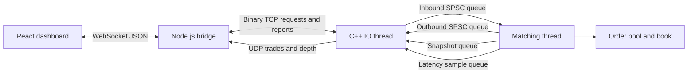

# FastBid

FastBid is a C++20 limit order book matching engine with a binary TCP gateway, a Node.js WebSocket bridge, and a React dashboard. It provides a complete **local paper-trading environment**: submit simulated limit orders, watch them match, inspect the book, and cancel your session's remaining orders.

The focus is predictable order processing: preallocated memory, one owner of the book, bounded queues, price-time priority, and measured latency. The project is not connected to an exchange and does not manage real funds, balances, or positions.

## Contents

- [Capabilities and scope](#capabilities-and-scope)
- [Quick start: local paper trading](#quick-start-local-paper-trading)
- [Try a complete trading workflow](#try-a-complete-trading-workflow)
- [Architecture](#architecture)
- [Matching rules and data structures](#matching-rules-and-data-structures)
- [Technology choices](#technology-choices)
- [Project layout](#project-layout)
- [Build and run from source](#build-and-run-from-source)
- [Configuration](#configuration)
- [Protocols and overload behavior](#protocols-and-overload-behavior)
- [Testing and performance measurement](#testing-and-performance-measurement)
- [Operations and troubleshooting](#operations-and-troubleshooting)
- [Limitations and future work](#limitations-and-future-work)

## Capabilities and scope

| Area | Implemented behavior |
| --- | --- |
| Matching | One instrument; limit BUY/SELL orders; best price first, then arrival order |
| Execution | Partial fills, multiple fills, execution at the resting order's price |
| Cancellation | The current owner session can cancel its resting orders |
| Modification | Internal cancel-and-replace implementation; not exposed over TCP or the dashboard |
| Memory | Fixed order pool, price array, intrusive order index, bounded SPSC queues |
| TCP | Binary NEW/CANCEL requests; correlated ACK/FILL/CANCEL_ACK/REJECT responses |
| Market data | Versioned trade packets and full top-10 depth snapshots |
| Dashboard | Order entry, open orders, cancellation, trades, depth, latency history, stale-feed indication |
| Local operation | Docker-based paper stack, startup helper, readiness endpoint, stop/reset commands |
| Validation | Unit tests, randomized reference model, sanitizer checks, socket/bridge integration, paper-stack smoke test |

SPSC means single-producer/single-consumer: exactly one thread writes a queue and exactly one other thread reads it. The matching path performs no heap allocation after startup. This does not mean the entire application never allocates: connection setup, JavaScript processing, and build tools do allocate.

## Quick start: local paper trading

### Prerequisites

- Windows: Docker Desktop running in Linux-container mode and PowerShell.
- Linux: Docker Engine and the Docker Compose plugin.
- A free local TCP port `8080`.
- Internet access for the first image/dependency build.

The container workflow does not require a locally installed C++ compiler, Node.js, or a separately opened WSL terminal. Run commands from the project root unless stated otherwise.

### Start

On Windows:

```powershell
.\paper.ps1 start
```

On either platform, the equivalent Docker command is:

```bash
docker compose -f compose.paper.yml up -d --build --wait --wait-timeout 120
```

Open **http://localhost:8080**. Wait for the dashboard to show **LIVE**. The first build takes longer because it downloads dependencies and compiles the engine and frontend.

The dashboard container serves the built web page, WebSockets, and health endpoint. The engine shares its isolated network namespace [the containers' network interfaces and ports], so the bridge reaches TCP and UDP over loopback. Only `127.0.0.1:8080` is published to the host. No host-network support or multicast routing is required for this paper stack.

### Manage the session

```powershell
.\paper.ps1 status  # Show containers and health
.\paper.ps1 logs    # Show recent diagnostics
.\paper.ps1 reset   # Discard all simulated orders and start an empty book
.\paper.ps1 stop    # Stop and remove containers
```

Direct Docker equivalents:

```bash
docker compose -f compose.paper.yml ps
docker compose -f compose.paper.yml logs --tail 100
docker compose -f compose.paper.yml down
```

To reset on Linux, run `down`, then the startup command. The PowerShell `reset` action reuses existing images; run `start` after source changes to rebuild them. If PowerShell blocks script execution, use the direct Docker command.

**State is volatile [kept only in process memory].** Stop, reset, or an engine restart discards the book. There is no recovery from disk.

## Try a complete trading workflow

1. Open the dashboard in two browser tabs. Each tab receives a separate trading session.
2. In tab A, submit **BUY**, price **10**, quantity **100**. The order should appear in **My Open Orders** and bid depth.
3. In tab B, submit **SELL**, price **10**, quantity **40**.
4. The engine trades 40 units at $10. Both tabs receive their own fill report. Tab A has 60 units left.
5. In tab A, click **Cancel**. Wait for `CANCEL_ACK`; the remaining order disappears.

The book begins empty, so an order will rest until a compatible opposite order arrives. There is no automated market maker supplying liquidity.

Prices in the UI are dollar values, not internal integer ticks. The allowed band is $5 through $15, with up to four decimal places. Quantity must be a positive whole number.

Keep the tab open while managing its orders. Refreshing or reconnecting creates a new session; it cannot recover cancellation access to the old session's orders. Reset the paper stack to clear those orders. An interrupted connection can leave acceptance uncertain, so the dashboard never automatically resubmits requests.

## Architecture



### Responsibilities

**Dashboard:** collects user input and presents acknowledgments, fills, open orders, book depth, trades, and diagnostics. The browser does not decide whether an order matched.

**Bridge:** translates browser JSON into the compact binary order protocol, creates one engine TCP connection per browser, routes private reports to their owner, and converts public UDP packets into browser messages. In the paper image it also serves built frontend files.

**IO thread:** the C++ main thread accepts TCP connections using Linux `epoll`, parses complete frames, queues requests, sends reports, publishes market data, and computes diagnostic percentiles. It owns the sockets.

**Matching thread:** owns the order pool and book. It validates requests, matches orders, and emits events. No other thread directly mutates the book.

Additional bounded queues transfer engine-owned snapshots and latency samples to IO. The separation prevents the networking and monitoring code from reading mutable book state concurrently.

## Matching rules and data structures

### Price-time priority

A buy matches the lowest eligible sell price. A sell matches the highest eligible buy price. At the same price, the oldest order fills first: FIFO [first in, first out]. A trade executes at the resting order's price, which may improve on the incoming order's limit.

For example, a resting SELL at $9.90 can match an incoming BUY limited to $10.00, and the trade price is $9.90. Unfilled incoming quantity rests at its own limit price.

### Storage

| Structure | Purpose and tradeoff |
| --- | --- |
| Flat price array | Direct lookup using `price - minimum_price`; reserves memory for empty prices too |
| Intrusive FIFO lists | Each order contains links to its neighbors; avoids allocating separate list nodes |
| Object pool | Reserves order slots at startup and recycles them through a free list |
| Intrusive hash index | Finds an order by exchange ID without allocating map nodes; collisions still require chain traversal |
| Occupancy bitmap | One bit per price indicates whether it contains orders, allowing scans to skip empty groups |
| SPSC ring buffers | Transfer fixed-size values between threads without a mutex; each queue has exactly one producer and consumer |

The implementation uses one price-level array. A correctly matched resting book never has crossing buy/sell prices, so opposite resting sides do not need to coexist at the same price. Prices are fixed-point integers: `$10.0001` is represented as `100001`, avoiding floating-point comparison errors.

Direct level lookup and pool slot allocation are constant-time operations. Order-ID lookup is expected constant time but can degrade with collisions. Removing a known list node is constant time; locating a new best price may scan bitmap words. Matching an order that fills many resting orders necessarily performs work for each fill.

## Technology choices

| Technology | Use in this project |
| --- | --- |
| C++20 | Explicit memory layout, fixed-capacity structures, atomics, bit operations, and Linux system calls |
| Linux `epoll` and nonblocking sockets | Manage multiple connections in one IO loop |
| TCP | Ordered byte stream for requests and private execution reports |
| UDP | Best-effort public trades/depth; multicast for native configuration, loopback unicast for paper containers |
| Node.js and `ws` | Browser WebSocket support kept outside the matching thread |
| React 18 | Dashboard state and rendering |
| Vite 8.3.4 / React plugin 6.1.2 | Frontend development and production asset builds; exact tool versions are in the package files |
| CMake / CTest / GoogleTest | C++ builds, test execution, and unit assertions; GoogleTest source revision is pinned |
| Python 3 | Real-process TCP integration checks |
| Docker / Compose | Repeatable build/runtime environments and multi-service lifecycle |
| PowerShell | Windows helper for paper-stack commands |

There is no database, `io_uring` integration, kernel-bypass implementation, or C++ WebSocket server in the current runtime.

## Project layout

```text
FastBid/
  README.md
  compose.paper.yml             Local complete paper-trading stack
  paper.ps1                     Windows lifecycle helper
  docs/PROTOCOL.md              Binary layouts and message semantics
  server/
    CMakeLists.txt
    Dockerfile
    docker-compose.yml          Alternative native-Linux host-network stack
    src/
      main.cpp                  Startup, thread ownership, telemetry, shutdown
      core/                     Orders, price levels, book, matching engine
      memory/                   Object pool and SPSC queue
      network/                  TCP gateway and UDP market data
      platform/                 CPU affinity and counter timing
      instrumentation/          Latency sample collection
    tests/                      Unit, reference-model, and socket tests
    benchmarks/                 Core benchmark and C++ allocation guard
  client/
    src/                        React dashboard
    ws_bridge.js                HTTP/WebSocket/TCP/UDP bridge
    Dockerfile.paper            Builds and serves the complete dashboard
    Dockerfile.bridge           Bridge-only image
    tests/                      Bridge integration and paper-stack smoke test
  deploy/
    setup_oracle_vm.sh          Ubuntu host provisioning helper
```

## Build and run from source

### C++ engine

Use Linux or Ubuntu under WSL. Required tools: a C++20 compiler, CMake 3.20+, Git, and Python 3 for tests. On Ubuntu:

```bash
sudo apt update
sudo apt install -y build-essential cmake git python3
```

From the project root:

```bash
cmake -S server -B build/release -DCMAKE_BUILD_TYPE=Release -DBUILD_TESTS=ON -DBUILD_BENCHMARKS=ON
cmake --build build/release -j
ctest --test-dir build/release --output-on-failure
./build/release/fastbid
```

CMake fetches GoogleTest during the first test-enabled configuration. For an offline checkout, pass `-DFETCHCONTENT_SOURCE_DIR_GOOGLETEST=/absolute/path/to/googletest`. Windows-native engine builds are rejected because the networking layer requires Linux.

### Bridge and frontend development

Use Node.js 22.12+ or 20.19+ for the current frontend toolchain. With the engine running, open a second terminal:

```bash
cd client
npm ci
node ws_bridge.js
```

Open a third terminal:

```bash
cd client
npm run dev
```

Visit the Vite address, normally `http://localhost:5173`. If Vite chooses a different port, configure the bridge's allowed origins to match. `npm ci` installs the lockfile versions. `npm run build` creates `client/dist/`, which the bridge can serve directly on port 8080; for that direct browser URL, also set its allowed origins to include `http://localhost:8080`.

Avoid running the paper stack and source bridge on the same host port simultaneously. In WSL, running engine, bridge, and development frontend together inside Linux avoids cross-environment UDP routing assumptions.

### Alternative native-Linux containers

```bash
docker compose -f server/docker-compose.yml up --build -d
```

This alternative uses host networking and multicast, and builds the **bridge-only** image. It does not package the React dashboard: run the development frontend separately. Prefer `compose.paper.yml` for a complete local workflow, especially on Docker Desktop. Do not launch both stacks on the same ports.

## Configuration

Environment variables [settings supplied when starting a process] configure the following values:

| Variable | Default outside paper Compose | Meaning |
| --- | --- | --- |
| `FASTBID_TCP_HOST` | `127.0.0.1` | Engine bind IPv4; bridge's engine destination |
| `FASTBID_TCP_PORT` | `9000` | Binary order entry |
| `FASTBID_UDP_MCAST_ADDR` | `239.255.0.1` | Engine UDP destination; bridge multicast membership |
| `FASTBID_UDP_MCAST_PORT` | `5000` | UDP market-data port |
| `FASTBID_WS_HOST` | `127.0.0.1` | Bridge HTTP/WebSocket bind address |
| `FASTBID_WS_PORT` | `8080` | Bridge HTTP/WebSocket port |
| `FASTBID_ALLOWED_ORIGINS` | localhost and 127.0.0.1 on port 5173 | Comma-separated allowed browser origins |
| `FASTBID_LOCK_MEMORY` | `0` | `1` attempts to lock existing engine mappings in RAM |
| `VITE_WS_URL` | Development: `ws://localhost:8080`; built UI: current page's host | Frontend build-time WebSocket URL override |

Paper Compose sets the engine's UDP destination to `127.0.0.1`, binds the bridge to all interfaces inside its container, and permits the two local port-8080 browser origins. The published host port remains loopback-only. Set frontend build-time variables before building the frontend; changing them in a running container does not rewrite compiled assets.

Current limits:

| Setting | Value |
| --- | --- |
| Instrument | `1` |
| Price band | `50000` to `150000` ticks inclusive, equivalent to $5-$15 |
| Reference price | `100000` ticks, equivalent to $10 |
| Price levels | `100001` |
| Order pool | `1048576` slots, including any pending aggressor |
| Inbound/outbound queues | `65536` slots each, `65535` usable |
| TCP clients | `1024` |
| Per-client TCP receive/send buffers | 8 KiB / 64 KiB |
| Browser clients | `256` |
| Browser request size | 4 KiB |
| Bridge command rate | 100/second/client, with a 100-command burst |
| Snapshot depth and interval | Top 10 per side, approximately 50 ms when engine progress allows |

Core capacities are compiled into the program; they are not all environment-configurable. Budget roughly 160 MiB for engine/queue state, plus connection buffers, kernel socket buffers, runtime overhead, and frontend services. Busy polling can use substantial CPU even when idle. CPU affinity uses the process's allowed CPU mask and normal scheduling. Optional memory locking does not lock future allocations and can fail without sufficient privileges.

## Protocols and overload behavior

The engine accepts little-endian binary TCP frames [messages with a defined byte layout]. NEW is 38 bytes; CANCEL is 16 bytes. Responses are ACK, FILL, CANCEL_ACK, and REJECT. Each frame includes its length and type. See [protocol details](docs/PROTOCOL.md) for exact field offsets, reject reasons, and public market-data formats.

The browser uses JSON, for example:

```json
{"type":"new_order","side":"BUY","price":10.0001,"quantity":100}
```

```json
{"type":"cancel","order_id":"123"}
```

Order IDs are strings in browser messages to avoid JavaScript integer precision loss. ACK means accepted by the in-memory engine, not saved durably.

When report capacity is insufficient, matching pauses between fills and retains the active order's priority. Later requests cannot overtake it. Inbound requests remain buffered until space becomes available; eventually TCP flow control slows the sender. Slow consumers exceeding the output bound are disconnected rather than permitted unlimited memory growth. A disconnect can still lose delivery of reports for already executed work.

TCP preserves byte order but not message boundaries; the parser handles split and combined frames. Invalid lengths/types/reserved fields close the connection. Engine validation rejects invalid prices, quantities, types, instruments, and unauthorized cancellation.

Public UDP data is best effort [delivery is not guaranteed]. One trade packet is published per match, while each participant receives a private fill. Full top-10 snapshots recover displayed depth after missed packets, but there is no replay for missed trades.

## Testing and performance measurement

### Memory and undefined-behavior checks

```bash
cmake -S server -B build/asan -DCMAKE_BUILD_TYPE=Debug -DBUILD_TESTS=ON -DENABLE_SANITIZERS=ON
cmake --build build/asan -j
ctest --test-dir build/asan --output-on-failure
```

ASan [AddressSanitizer] detects many memory access errors. UBSan [UndefinedBehaviorSanitizer] detects operations that violate C++ rules. For concurrent-access checking, use a separate build:

```bash
cmake -S server -B build/tsan -DCMAKE_BUILD_TYPE=Debug -DBUILD_TESTS=ON -DENABLE_TSAN=ON
cmake --build build/tsan -j
./build/tsan/tests/fastbid_tests --gtest_filter=SPSCQueueTest.ConcurrentProducerConsumer:Stats.ConcurrentTransferAccountsForEverySample
```

TSan [ThreadSanitizer] checks for data races. Do not combine it with ASan in one build. These tools are diagnostic checks, not proofs of correctness for every possible input.

### Integration checks

The CTest suite includes Python socket tests that launch a real engine on temporary ports. Bridge integration also launches its own engine and bridge; run from `client/` on Linux after `npm ci`:

```bash
node tests/bridge_integration.mjs ../build/release/fastbid
```

For the running Docker paper stack, start with an empty book and run from the project root:

```bash
node client/tests/paper_smoke.mjs
```

The paper smoke test submits simulated orders and checks HTTP assets, health, restricted asset serving, acknowledgments, cancellation, two-session matching, and book snapshots. It requires client dependencies. Do not run it against a session whose test orders you want to preserve.

The recorded validation on 2026-10-13 passed 33 CTest cases in Release and ASan/UBSan, two selected concurrency cases under TSan, bridge integration, and the paper-stack smoke test. These are historical results, not a claim that tests run automatically every time the application starts.

### Benchmark scope

```bash
./build/release/fastbid_bench
```

The benchmark warms up with 10,000 requests, then measures 100,000 alternating resting/full-fill requests at production capacities. It includes inbound queue insertion, core processing, and outbound event draining. A C++ allocation guard detects calls to standard allocation operators in that measured workload. It is not a universal detector for every possible allocator or workload.

It excludes sockets, gateway parsing, snapshot work, browser activity, persistence, and realistic multi-client network contention. Previously observed WSL results were sub-microsecond for this workload; they are not an end-to-end latency guarantee. Record hardware, compiler, build flags, load, and workload whenever comparing results.

Dashboard latency is a different measurement: engine request processing through completion, including report-pressure pauses and scheduling interruptions. It excludes inbound queue wait and network ingress. p50 is the median; p99 describes the slower edge of the retained sample distribution. Sample drops are counted and can bias those values. Throughput includes processed NEW, CANCEL, and rejected requests, not just trades. An idle sample window has no meaningful percentile.

## Operations and troubleshooting

`http://localhost:8080/healthz` returns 200 when the bridge has received a snapshot within two seconds, otherwise 503. It checks feed freshness, not every possible trading operation. The dashboard separately waits for its own engine connection and marks missing market data stale.

| Symptom | What to check |
| --- | --- |
| Docker command fails | Docker daemon/Desktop is running, using Linux containers, and accessible to your user |
| Port 8080 already allocated | Stop the conflicting bridge/stack; inspect `docker ps` before starting another stack |
| Startup timeout | Inspect `docker compose -f compose.paper.yml logs --tail 100`; first-time builds need network access |
| Browser cannot connect | Use the exact local URL and check container status, HTTP health, and allowed origin |
| Dashboard shows stale data | Inspect engine and UDP-feed logs; the UI does not generate substitute data |
| An order does not trade | The opposite book may be empty or prices may not cross |
| Price or quantity rejected | Use UI dollars in [5,15], at most four decimals, and a positive integer quantity |
| Open orders disappear after refresh | New browser session; older orders can remain in the engine until matched or stack reset |
| Connection closes under load | Review malformed input, rate limits, and slow-consumer buffer limits; do not blindly retry |
| Changes are not reflected | Rebuild with `paper.ps1 start` or Compose `up --build`; reset alone reuses images |
| Native frontend fails to build | Use the documented Node version and `npm ci` from `client/` |

On SIGINT/SIGTERM [process stop signals], IO stops admitting requests. The engine drains requests already in its inbound queue. After engine completion, application TCP buffers get up to two seconds to flush. Partial or buffered requests not yet admitted are not guaranteed execution. Compose allows 30 seconds before forced termination, so very large drains can exceed that outer limit. Resting orders are discarded at exit.

## Limitations and future work

The current scope is local paper trading and systems engineering. Before live trading, the project needs durable journal/replay [saved operations that can rebuild state], authenticated accounts, account risk/credit checks, duplicate-request suppression, reconnect and execution recovery, failover, authenticated market data, and target-hardware capacity testing.

There is no automatic cancel-on-disconnect, user account ledger, market order, multi-instrument routing, historical trade replay, or guaranteed delivery after disconnection. Sequence and exchange IDs restart with the engine process. Origin filtering and session ownership are not account authentication. Keep the local stack private.

Performance work should preserve correctness first: benchmark representative sparse/dense books, large sweeps, cancellations, many clients, saturated queues, and shutdown behavior before making latency claims.
